<div align="center">

# MPI Sieve of Eratosthenes

**Five progressive parallel implementations of the Sieve of Eratosthenes in C + MPI — from the textbook baseline to a bit-packed, cache-tiled version — with the complete benchmark results measured on a 96-core cluster.**

[](LICENSE)


</div>

---

## Table of contents

- [Overview](#overview)
- [Algorithm](#algorithm)
- [The five versions](#the-five-versions)
- [Quick start](#quick-start)
- [Results](#results)
- [Screenshots](#screenshots)
- [Repository layout](#repository-layout)
- [Measurement methodology](#measurement-methodology)
- [Running at larger scales](#running-at-larger-scales)
- [License](#license)
- [Author](#author)

---

## Overview

The **Sieve of Eratosthenes** finds every prime number up to a limit `n` by repeatedly
crossing out the multiples of the primes it has already found. It is a classic example
of a program that is trivial to parallelise *data-wise* (every process can own a slice of
the list) but surprisingly hard to make **fast**, because

- the marking loop has a very irregular memory-access pattern, and
- the naive version needs a broadcast for every sieving prime.

This repository contains five self-contained programs that solve the same problem and are
built on top of each other. Each one adds exactly **one** optimisation, so the effect of
every step can be measured in isolation.

All five programs produce identical results, are checked against the known values of
π(n), and print the marking time and the total wall-clock time.

---

## Algorithm

```
             ┌──────────────────────────────────────────────────────┐
             │ n = limit (command line),  p = number of processes   │
             └──────────────────────────────────────────────────────┘
                                  │
                  block decomposition (method 2)
        process id owns values 2 .. n  with  BLOCK_LOW/HIGH/SIZE
                                  │
        ┌─────────────────────────┴──────────────────────────┐
        │  repeat until k*k > n                              │
        │    1. build the list of the multiples of k         │
        │       that fall inside the local block, starting   │
        │       at max(k*k, first multiple >= low_value)      │
        │    2. mark them as composite                       │
        │    3. determine the next sieving prime k           │
        │       (broadcast in base, computed locally later)  │
        └─────────────────────────┬──────────────────────────┘
                                  │
                   count the unmarked values locally
                                  │
                    MPI_Reduce(MPI_SUM) → π(n) on rank 0
                    MPI_Reduce(MPI_MAX) → largest prime
```

* The list `2 … n` is split into `p` contiguous blocks; the first `(n-1) mod p` blocks
  hold one element more than the others (`BLOCK_LOW`, `BLOCK_HIGH`, `BLOCK_SIZE` macros
  from the course material).
* Marking always starts at `k*k`, because every smaller multiple of `k` has already been
  crossed out by a smaller prime.
* The loop stops when `k*k > n`; all remaining unmarked values are prime.
* Timings are taken with `MPI_Wtime()` and reduced with `MPI_MAX`, so the reported value
  is the wall-clock time of the **slowest** rank (the real duration of the parallel run),
  not an average that hides load imbalance.

---

## The five versions

| # | File | Optimisation added | What changes |
|:-:|------|--------------------|--------------|
| 0 | [`base.cpp`](code/base.cpp) | — *(baseline)* | Literal implementation: byte per candidate, rank 0 finds the next sieve prime and `MPI_Bcast`s it, `MPI_Reduce` collects the counts. |
| 1 | [`optimize1.cpp`](code/optimize1.cpp) | **Remove the even numbers** | Only odd candidates are stored and marked (2 is handled separately), so half of the candidates disappear immediately — half the work *and* half the memory. |
| 2 | [`optimize2.cpp`](code/optimize2.cpp) | **Eliminate the broadcast** | Every rank computes all primes up to `√n` in a small private array, so the marking loop contains **no MPI communication at all**. |
| 3 | [`optimize3.cpp`](code/optimize3.cpp) | **Loop reorganisation + cache optimisation** | The local block is processed in 32 KB tiles (≈ L1 cache size); the loops are interchanged so that a tile is marked for all sieving primes before moving to the next tile. |
| 4 | [`optimize4.cpp`](code/optimize4.cpp) | **Bit packing + fast counting** | 1 bit per odd candidate (8× less memory than a `char` array), `calloc` initialisation, and `popcount`-based counting with `MPI_Reduce`. |

`optimize4` contains **all** of the above, so it is the version used for the final
grading run. Each program is standalone (no shared headers) so that it can be compiled and
submitted on its own.

---

## Quick start

### Requirements

- An MPI implementation providing `mpic++` and `mpirun`
  (tested with **MPICH 4.0 / Hydra**; Open MPI works too)
- A C++ compiler (tested with **g++ 11.4.0**)
- Linux, macOS or WSL — any POSIX shell

```bash
# Debian / Ubuntu
sudo apt install build-essential mpich
```

### Build

```bash
cd code
for v in base optimize1 optimize2 optimize3 optimize4; do
    mpic++ -O3 -o $v $v.cpp
done
```

### Run

```bash
# general form
mpirun -np <processes> ./<version> <n>

# correctness check (π(10^8) = 5 761 455)
mpirun -np 4 ./optimize4 100000000

# the "official" grading parameters of the experiment
mpirun -np 8 ./optimize4 4000000000
```

Expected output (abridged):

```
=================================================================
 Parallel Sieve of Eratosthenes -- OPTIMIZE 4 (FINAL)
 student : 2023080146011      n = 4000000000      processes = 8
-----------------------------------------------------------------
 189961812 primes are less than or equal to 4000000000
 largest prime found             : 3999999979
 marking (sieve) time    [max]   :   0.555557 s
 total elapsed time      [max]   :   0.635679 s
=================================================================
```

### Ready-made test scripts

| Script | Purpose |
|--------|---------|
| [`code/run_all.sh`](code/run_all.sh) | Compile everything, then run correctness (`n=10^8`), scaling (`n=10^9`, np = 1…8) and the grading run (`n=4·10^9`, np = 8). Writes the raw logs into `results/`. |
| [`code/run_final.sh`](code/run_final.sh) | The grading run plus the scaling of the final version with np = 1, 2, 4, 8, 16. |
| [`code/run_repeat.sh`](code/run_repeat.sh) | Repeats every measurement 3 times (used for the minimum-of-three figures below). |
| [`code/summary_table.sh`](code/summary_table.sh) | Parses `results/final_4e9.txt` into a one-line-per-configuration table. |
| [`code/capture_compile.sh`](code/capture_compile.sh), [`code/capture_session.sh`](code/capture_session.sh) | Re-run the build / the main commands and print a readable transcript (this is what the screenshots show). |

The scripts are the ones that were **actually used for the measurements**, so they expect
the sources to sit next to them in one working directory (on the cluster: `~/mpi_exp`)
and they write their logs to `./results`. To reproduce exactly:

```bash
mkdir -p ~/mpi_exp && cp code/* ~/mpi_exp/ && cd ~/mpi_exp && ./run_all.sh
```

---

## Results

All numbers below are the **minimum of three repetitions** of the same configuration
(the server is shared, so the minimum is the least noisy estimator). Times are in
seconds, measured with `MPI_Wtime()` and reduced with `MPI_MAX`.

### 1. Correctness — `n = 10^8`, 4 processes

All five versions agree with the reference value π(10^8) = **5 761 455** and with the
largest prime 99 999 989.

| Version | π(10^8) | Largest prime | Marking [s] | Total [s] |
|---------|--------:|--------------:|------------:|----------:|
| `base`      | 5 761 455 | 99 999 989 | 0.255326 | 0.303160 |
| `optimize1` | 5 761 455 | 99 999 989 | 0.090111 | 0.119998 |
| `optimize2` | 5 761 455 | 99 999 989 | 0.083944 | 0.112349 |
| `optimize3` | 5 761 455 | 99 999 989 | 0.025376 | 0.067389 |
| `optimize4` | 5 761 455 | 99 999 989 | 0.058180 | 0.066768 |

> Raw log: [`results/correct_all.txt`](results/correct_all.txt)

### 2. Strong scaling — `n = 10^9`

Total elapsed time [s]; the last column is the speed-up of the same version between 1
and 8 processes (π(10^9) = 50 847 534).

| Version | np = 1 | np = 2 | np = 4 | np = 8 | Speed-up (1→8) |
|---------|-------:|-------:|-------:|-------:|---------------:|
| `base`      | 13.081 | 6.913 | 3.882 | 2.271 | 5.8× |
| `optimize1` |  6.656 | 3.561 | 1.907 | 1.106 | 6.0× |
| `optimize2` |  6.634 | 3.481 | 1.883 | 1.103 | 6.0× |
| `optimize3` |  1.893 | 0.951 | 0.490 | 0.263 | 7.2× |
| `optimize4` |  1.027 | 0.539 | 0.278 | 0.159 | 6.4× |

> Raw log: [`results/scaling_1e9.txt`](results/scaling_1e9.txt)

### 3. Grading run — `n = 4·10^9`, 8 processes

π(4·10^9) = **189 961 812**, largest prime **3 999 999 979**.

| Version | Marking [s] | Total [s] | Speed-up vs. `base` |
|---------|------------:|----------:|--------------------:|
| `base`      | 8.547 | 9.419 |  1.00× |
| `optimize1` | 4.423 | 4.990 |  1.89× |
| `optimize2` | 4.152 | 4.672 |  2.02× |
| `optimize3` | 0.389 | 0.981 |  9.60× |
| `optimize4` | 0.524 | 0.600 | **15.70×** |

> Raw log: [`results/final_4e9.txt`](results/final_4e9.txt)

`optimize4` marks slightly *slower* than `optimize3` (bit tests cost a few extra
instructions) but wins on the total time — the 8× smaller array improves the cache
behaviour — and it needs only one eighth of the memory.

### 4. Strong scaling of the final version — `n = 4·10^9`

| Processes | Total [s] | Speed-up | Efficiency |
|----------:|----------:|---------:|-----------:|
|  1 | 4.374 |  1.00× | 100 % |
|  2 | 2.272 |  1.93× | 96 % |
|  4 | 1.133 |  3.86× | 97 % |
|  8 | 0.603 |  7.25× | 91 % |
| 16 | 0.333 | 13.15× | 82 % |

> Raw log: [`results/repeat.txt`](results/repeat.txt) · parsed data: [`results/summary_all.csv`](results/summary_all.csv), [`results/summary.json`](results/summary.json)

### 5. Memory — `n = 4·10^9`, 8 processes

| Version | Candidate array per process | Representation |
|---------|----------------------------:|----------------|
| `base` | 476.8 MB | 1 byte per number |
| `optimize1` … `optimize3` | 238.4 MB | 1 byte per **odd** number |
| `optimize4` | **29.8 MB** | 1 **bit** per odd number |

### Figures

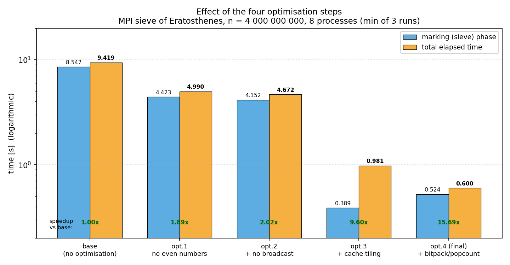

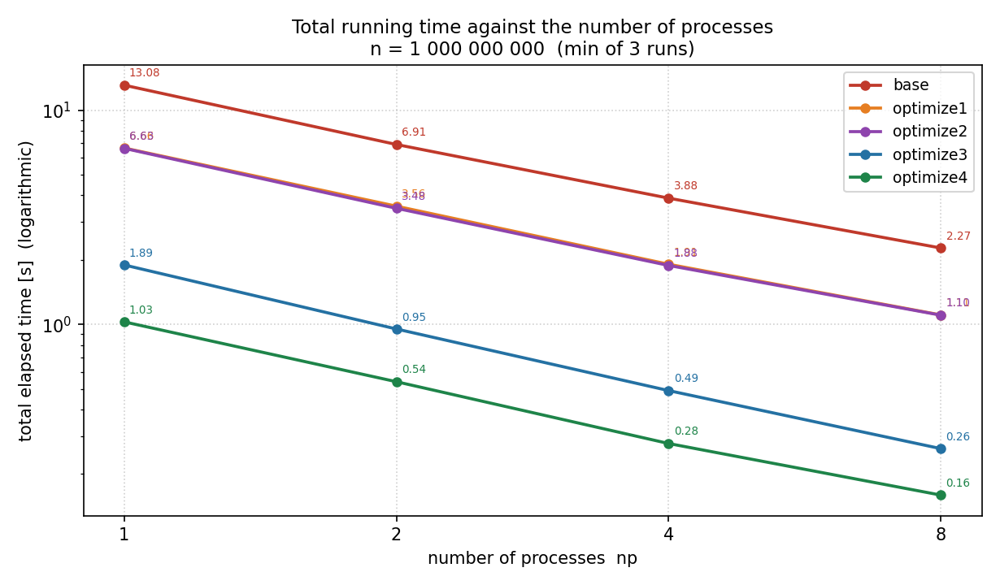

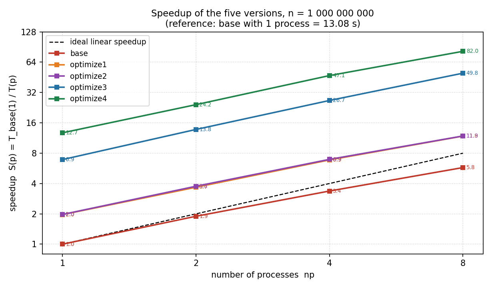

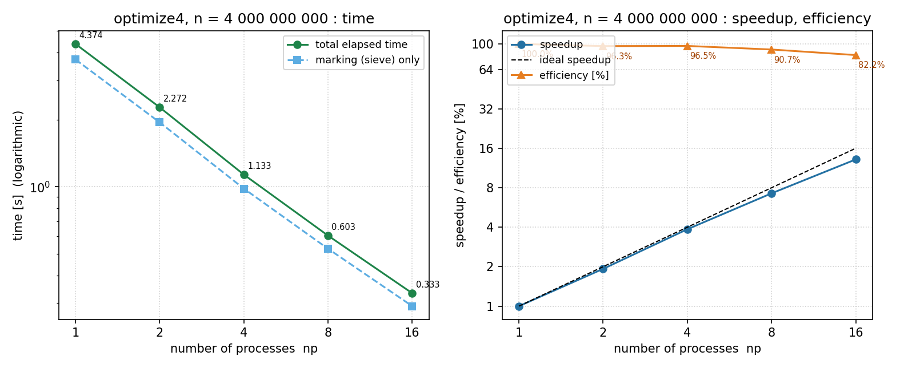

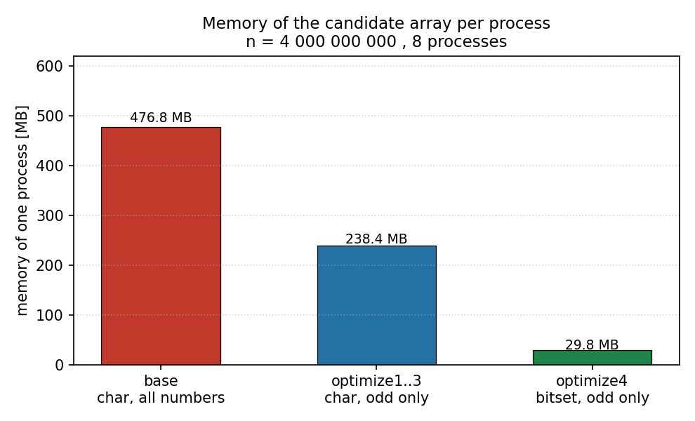

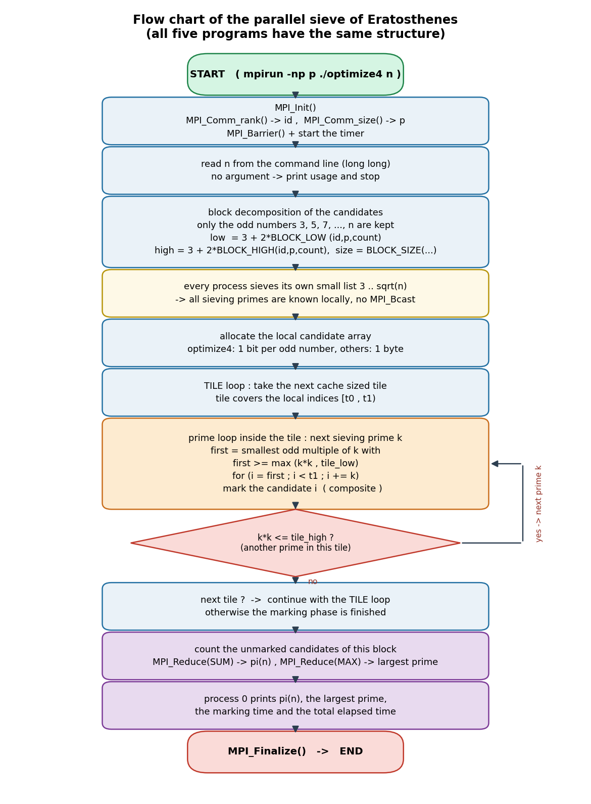

---

## Screenshots

The screenshots were taken while running the experiment on the laboratory cluster
(Ubuntu 22.04.5 LTS, 96 logical CPUs, 503 GiB RAM). They are stored in
[`screenshots/`](screenshots) and show the real terminal output of the runs.

<table>
<tr>
<td width="50%"><a href="screenshots/shot1_login.png">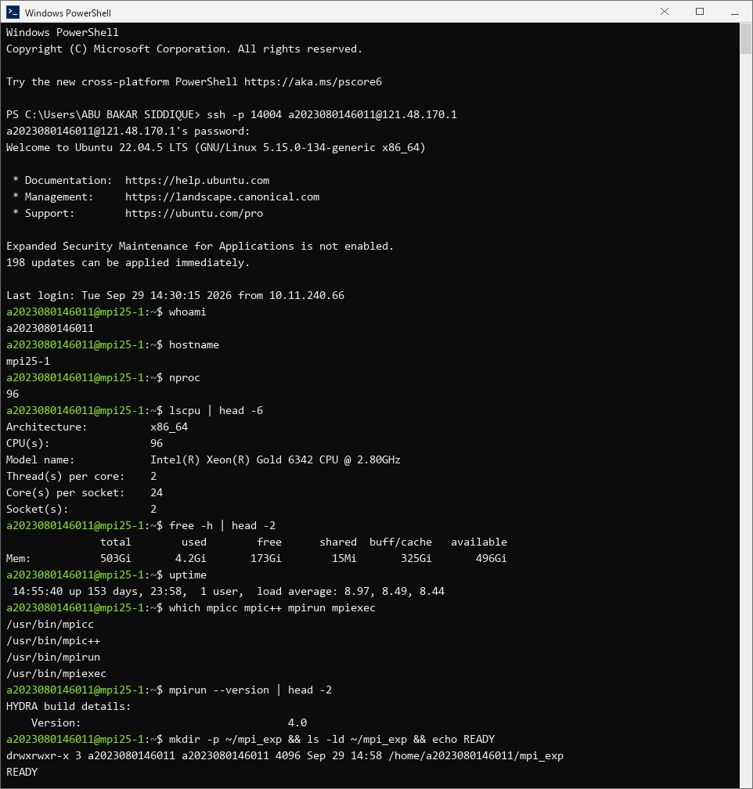</a><br><sub><b>1</b> — logging into the cluster and checking the environment (96 CPUs, 503 GiB RAM, MPICH)</sub></td>
<td width="50%"><a href="screenshots/shot2_upload.png">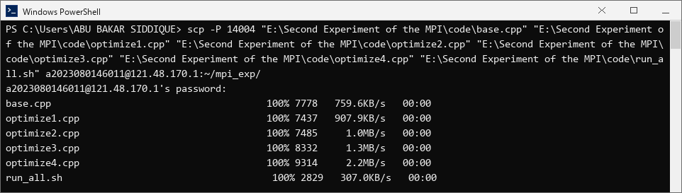</a><br><sub><b>2</b> — uploading the five sources and the run script</sub></td>
</tr>
<tr>
<td width="50%"><a href="screenshots/shot3_compile.png">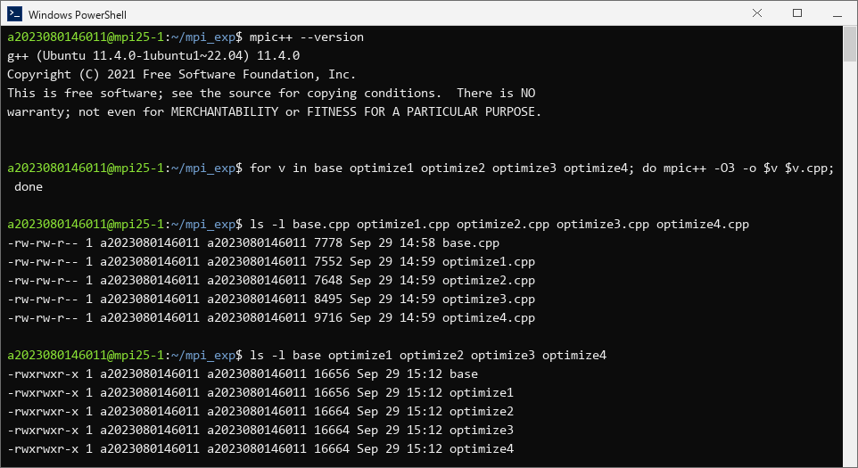</a><br><sub><b>3</b> — compiling all five versions with <code>mpic++ -O3</code></sub></td>
<td width="50%"><a href="screenshots/shot4_correctness.png">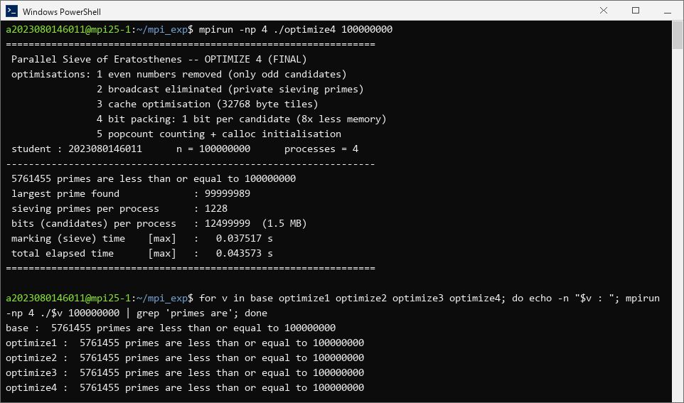</a><br><sub><b>4</b> — correctness check, n = 10^8</sub></td>
</tr>
<tr>
<td width="50%"><a href="screenshots/shot5_grading.png">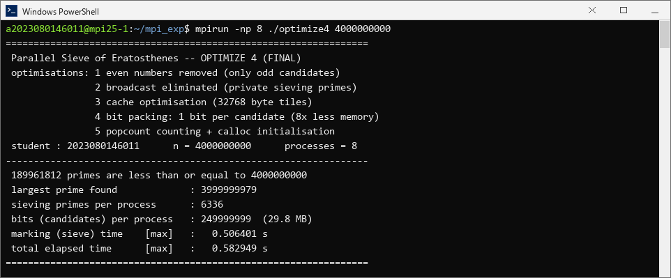</a><br><sub><b>5</b> — grading run of the final version (n = 4·10^9, 8 processes)</sub></td>
<td width="50%"><a href="screenshots/shot6_all_versions.png">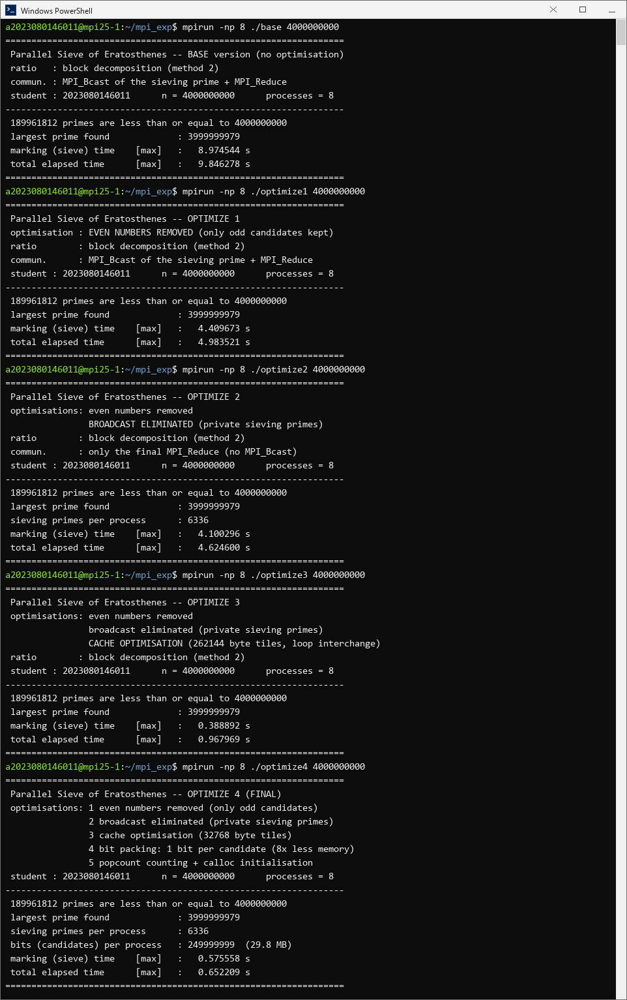</a><br><sub><b>6</b> — all five versions with the grading parameters</sub></td>
</tr>
<tr>
<td width="50%"><a href="screenshots/shot7_summary.png">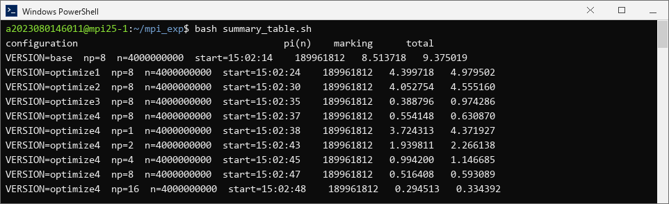</a><br><sub><b>7</b> — summary table extracted from the log</sub></td>
<td width="50%"><a href="screenshots/shot8_scaling.png">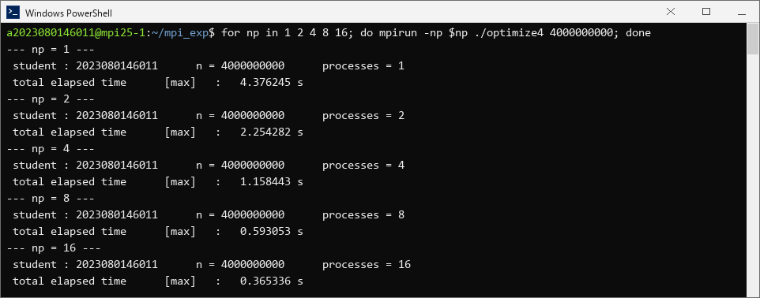</a><br><sub><b>8</b> — scaling of the final version, np = 1…16</sub></td>
</tr>
<tr>
<td width="50%"><a href="screenshots/shot9_files.png">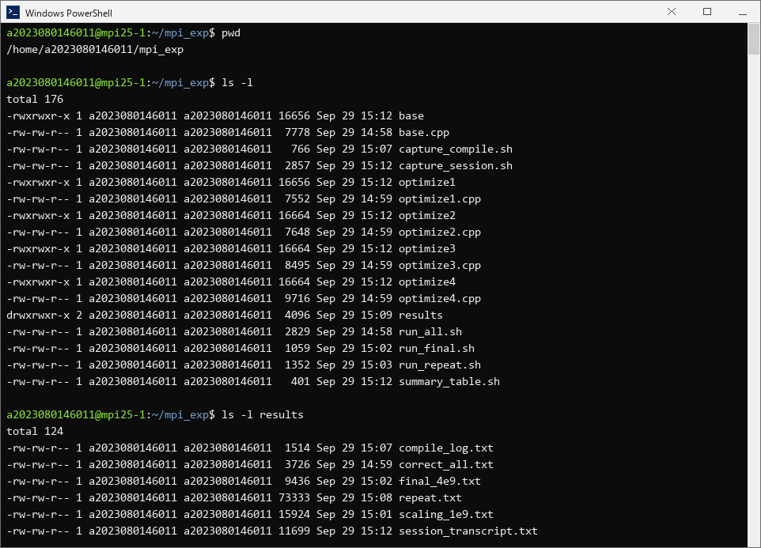</a><br><sub><b>9</b> — the project directory on the cluster</sub></td>
<td width="50%"></td>
</tr>
</table>

---

## Repository layout

```
.
├── code/                     # the five implementations + the run scripts
│   ├── base.cpp              #   baseline
│   ├── optimize1.cpp         #   + no even numbers
│   ├── optimize2.cpp         #   + no broadcast
│   ├── optimize3.cpp         #   + cache tiling
│   ├── optimize4.cpp         #   + bit packing (final version)
│   ├── run_all.sh            #   compile + correctness + scaling + grading
│   ├── run_final.sh          #   grading run + scaling up to 16 processes
│   ├── run_repeat.sh         #   3 repetitions of every measurement
│   ├── summary_table.sh      #   parse a run log into a table
│   ├── capture_compile.sh    #   reproducible compile transcript
│   └── capture_session.sh    #   reproducible transcript of the main runs
├── results/                  # raw measurement logs (unedited program output)
│   ├── compile_log.txt
│   ├── correct_all.txt
│   ├── scaling_1e9.txt
│   ├── final_4e9.txt
│   ├── repeat.txt            #   3 repetitions of every configuration
│   ├── session_transcript.txt
│   ├── summary_all.csv       #   parsed: test, version, np, n, rep, times
│   └── summary.json          #   parsed: minimum per configuration
├── figures/                  # plots generated from results/
├── screenshots/              # terminal screenshots of the real runs
├── LICENSE                   # MIT
└── README.md
```

---

## Measurement methodology

| Item | Value |
|------|-------|
| Cluster | 2 × Intel Xeon Gold 6342 @ 2.80 GHz — 24 cores/CPU, 2 threads/core → **96 logical CPUs** |
| Memory | 503 GiB |
| OS / kernel | Ubuntu 22.04.5 LTS, Linux 5.15.0-134-generic |
| MPI / compiler | MPICH 4.0 (Hydra) and g++ 11.4.0 (Ubuntu 11.4.0-1ubuntu1~22.04) |
| Compiler flags | `mpic++ -O3` |
| Timer | `MPI_Wtime()`, reduced with `MPI_MAX` (slowest rank) |
| Repetitions | 3 per configuration, **minimum** reported |
| Load | documented in [`results/repeat.txt`](results/repeat.txt) — the machine is shared, the load average is printed before and after each batch |
| Reference values | π(10^8) = 5 761 455 · π(10^9) = 50 847 534 · π(4·10^9) = 189 961 812 |

Because the cluster is shared, absolute times vary a few percent between runs; the
*relative* order of the five versions is stable, which is what the optimisation study
is about.

---

## Running at larger scales

The programs take `n` as a `long long`, so `n` up to ≈ 10^18 is representable, but three
practical limits apply:

1. **Memory** — `base` needs `n/p` bytes; `n = 10^10` with 8 processes needs ≈ 1.2 GB
   per process, `optimize4` only ≈ 75 MB.
2. **`k*k` overflow** — the sieving loop compares `prime * prime <= n`; keep
   `n < 2^62` so that `prime * prime` cannot overflow a signed 64-bit integer.
3. **`base` and `optimize1` require rank 0 to own all primes ≤ √n**
   (they print `Too many processes` otherwise) — that is the check from the course
   material, and it limits how many processes can be used for a given `n`.
   `optimize2`, `optimize3` and `optimize4` build their private table of sieving primes
   and therefore have no such limit.

---

## License

This project is released under the [MIT License](LICENSE).

## Author

**SIDDIQUE ABU BAKAR** — student ID 2023080146011
Parallel Programming course, MPI Experiment 2 (*The Sieve of Eratosthenes*).
